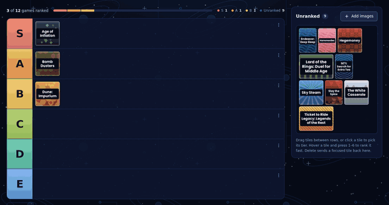
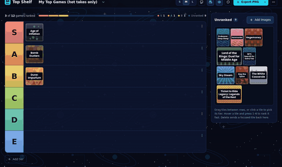

# Top Shelf

A free little tier-list maker for board games. Drag your box art into **S, A, B, C, D and E** tiers, make it look fun, and export the result as a picture.

No account, no ads, no install. Everything stays on your own computer.

*The sample games in these clips are made-up box art with silly spoofs of recent BGG favourites.*

**Want to try it?** Jump to [Get started](#get-started). It takes about a minute and there's nothing to install: download the ZIP, unzip, and double-click `index.html`.

## What you can do

- **Rank by dragging**, or hover a game and press **1 to 6** (S to E). **0** sends it back to Unranked.
- **Make the tiers yours:** rename, recolour, reorder, add or delete tiers.
- **Keep several lists**, for example "2-player games", "party games" or "bought, never played".
- **Save automatically** to a folder you choose, with one-click backup and restore.
- **Export** your tier list as a PNG, copy it, or share it.
- **Pick a look** from 18 themes: dark, light, genres (War, Horror, Sci-fi, Fantasy, Solo, Pirates, Party, Eurogame), game parts (Card table, Hex trader, Chip stack, Chess club, Co-op map) and a few just for fun (Dice night, Meeple party, Dungeon crawl).
- **Cinematic effect** (just for fun, easy to turn off): new covers fly in, ranked games hop into their tier with a little landing thud, and the rank popup flips out of the tile you click.

## Get started

You need **Google Chrome or Microsoft Edge** on Windows, Mac or Linux. There is nothing to install.

1. On this page click the green **Code** button, then **Download ZIP**.
2. Unzip it anywhere.
3. Double-click **index.html**. If it opens in the wrong browser, right-click it, choose **Open with**, then Chrome or Edge.
4. Click **Choose folder…**, pick an empty folder for your lists, and allow access. From then on everything saves by itself.
5. Click **Try with sample games** to look around, or add your own games (see below).

Next time, open `index.html` again and choose the same folder to carry on where you left off.

## Adding your own games

Top Shelf only shows pictures you add yourself.

1. Open a game's page on [BoardGameGeek](https://boardgamegeek.com), right-click the main image and choose **Save image as**.
2. **Rename the file to the game's name.** The file name becomes the title, so `Wingspan.jpg` becomes "Wingspan".
3. Drag the files onto the page, paste them, or click **Add images**.

Adding the same picture twice is skipped, so you won't get duplicates.

## Using it

**Ranking.** Drag a game into a tier, or click it to open the rank popup and pick a tier. Hover a game and press 1 to 6 for the fast way. The **×** on a ranked game sends it back to Unranked.

**Tiers.** Click a tier's letter to rename it. The **⋮** menu on a row lets you change its colour, move it, clear it or delete it. **Add tier** is under the board.

**Lists.** Click the list title at the top to switch lists, add a new one or duplicate the current one. **⋯ > Reset list** clears the current list.

**Toolbar.** From left to right: tile size (S, M, L), show or hide game names, the movie camera (cinematic effect on or off), the eye (hover preview), and the palette (themes).

**Saving and sharing.** **Export PNG** gives you a picture of your tier list, and the arrow beside it can copy the image or share it. **⋯ > Back up all lists** saves everything, pictures included, as one file, and **⋯ > Import backup** brings it back.

Press **?** in the app for a short how-to.

## Good to know

- **Browsers.** Saving to a folder works in Chrome and Edge. In Firefox and Safari the app still works, but it can't save to a folder, so use **⋯ > Back up all lists** before you close the tab.
- **Your data.** Your lists are ordinary files in the folder you picked (a small `.json` file per list, and an `images` folder). Nothing is uploaded anywhere. You can copy or back up the folder like any other.
- **Big collections.** I've only tested it with the number of games I own, plus a quick stress test with a few hundred made-up covers, which held up fine. If you own a lot of games and put them all in one list, it may slow down or misbehave, and the tiles get very small. Splitting a big collection into several lists is the safer way.
- **Turning off the effects.** If the cinematic effect is too much, click the movie-camera button. It also switches itself off if your computer is set to reduce motion.

## Or use it online (optional)

You can host your own copy so you can open it from any browser:

- **GitHub Pages:** unzip the download, upload all files to your repository, go to Settings > Pages > Deploy from a branch > `main` / root.
- **Netlify:** unzip the download and drop the folder onto <https://app.netlify.com/drop> to get your own link.

Your lists are still saved on the computer you use, never on the host. The link isn't password-protected, so share it only with people you trust. I'm not affiliated with Netlify or GitHub. Free plans have usage limits; if you use up the allowance, the hosted link stops working until it resets or you upgrade (the downloaded copy is unaffected).

## License

Top Shelf is free for **non-commercial** use under the [PolyForm Noncommercial License 1.0.0](LICENSE). You may not sell it or use it for commercial gain.

Made by dbkungfu for fun, with AI assistance. Box art shown in the app belongs to its publishers and artists.
